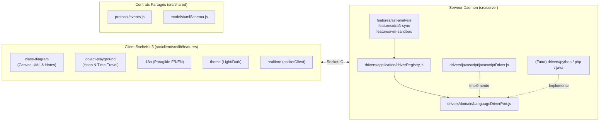

# Guide d'Exploitation Rapide Développeur (`DOCS_DEV.md`)

Ce document résume l'essentiel pour comprendre, modifier et faire évoluer **SeePOO** en moins de 5 minutes.

---

## 1. Stack Technique & Packages

### Runtime & Packaging (Hybride Bun + Node/NPM)
- **Développement** : Optimisé pour **Bun** (`bun install`, `bun run dev`, `bun start`, `bun run test:ast`).
- **Distribution universelle** : 100 % compatible **Node.js >= 18** (`npx seepoo` ou `bunx seepoo`).

### Frontend (`src/client/`)
| Package | Rôle dans le projet |
| :--- | :--- |
| **`svelte` (v5 - Runes)** | Réactivité fine granulaire (`$state`, `$derived`, `$effect`, `$props`) idéale pour les canvas 2D à 60 FPS, sans JSX. |
| **`@sveltejs/kit` + `@sveltejs/adapter-static`** | Shell applicatif SPA compilé dans `dist/client/` et servi par le démon local. |
| **`@inlang/paraglide-js`** | Internationalisation (i18n) **FR / EN** compilée statiquement depuis `src/client/messages/fr.json` et `src/client/messages/en.json`. |
| **`@lucide/svelte`** | Icônes vectorielles dédiées Svelte 5. |
| **`socket.io-client`** | Synchronisation temps réel bidirectionnelle avec le serveur local. |
| **CSS `light-dark()` + `color-scheme`** | Thème **Clair / Sombre** natif sans flash au chargement (FOUC prevention dans `src/client/src/app.html`). |

### Backend Daemon (`src/server/`)
| Package | Rôle dans le projet |
| :--- | :--- |
| **`express` + `socket.io`** | Serveur HTTP + WebSockets temps réel qui conserve l'état mémoire des objets vivants. |
| **`chokidar` + `glob`** | Observation temps réel des fichiers sources et du brouillon `.poo-draft.json`. |
| **`@babel/parser`, `@babel/traverse`, `@babel/generator`** | Driver JavaScript : extraction AST des classes/méthodes/propriétés/JSDoc et instrumentation des champs privés `#`. |
| **`node:vm`** | Bac à sable d'exécution dynamique pour instancier de vrais objets et exécuter leurs méthodes. |
| **`commander` + `chalk` + `open`** | Interface CLI (`seepoo start`, `seepoo init`). |

---

## 2. Architecture Logicielle : Feature-First + Architecture Hexagonale (Ports & Adapters)

Le projet couple **Feature-First** (découpage par fonctionnalité métier) et **Architecture Hexagonale** (`domain` / `application` / `infrastructure` + `drivers`) pour supporter plusieurs langages de programmation (JavaScript aujourd'hui, Python / PHP / Java / TypeScript demain) sans jamais modifier le front ni les UseCases.



### Arborescence commentée

```text
seepoo/
├── AGENTS.md / GEMINI.md               # Contexte & règles d'architecture pour agents IA
├── .agents/ & .gemini/ & .vscode/      # Skills IA (Svelte 5, LanguageDriver) & serveur MCP @sveltejs/mcp
├── bin/cli.js                          # Entrée CLI (seepoo start --dir ... --port ... --lang ...)
├── src/
│   ├── shared/                         # Contrats partagés Client <-> Serveur
│   │   ├── protocol/events.js          # Noms d'événements WebSocket & métadonnées des langages
│   │   └── models/umlSchema.js         # Modèle UML universel indépendant du langage
│   ├── server/
│   │   ├── index.js                    # Bootstrapper HTTP + Socket.IO + Chokidar
│   │   ├── drivers/                    # PORTS & ADAPTERS MULTI-LANGAGES
│   │   │   ├── domain/LanguageDriverPort.js    # Contrat abstrait de tout langage
│   │   │   ├── application/driverRegistry.js   # Registre des drivers de langages
│   │   │   ├── javascript/javascriptDriver.js  # Driver JavaScript ES2024 actif
│   │   │   ├── typescript/typescriptDriver.js  # Driver TypeScript actif
│   │   │   ├── python/pythonDriver.js          # Driver Python 3 actif
│   │   │   └── java/javaDriver.js              # Driver Java actif
│   │   └── features/
│   │       ├── ast-analysis/           # Analyse statique AST & inférence de types
│   │       ├── draft-sync/             # Réconciliation AST <-> .poo-draft.json
│   │       └── vm-sandbox/             # Exécution d'instances & Time-Travel
│   └── client/                         # Projet SvelteKit 2 + Svelte 5 autonome
│       ├── svelte.config.js            # Config SvelteKit (adapter-static -> ../../dist/client)
│       ├── vite.config.js              # Config Vite + Paraglide + Proxy Socket.IO
│       ├── project.inlang/             # Config Inlang Paraglide
│       ├── messages/                   # Dictionnaires Paraglide i18n (fr.json, en.json)
│       └── src/
│           ├── routes/                 # Shell SvelteKit (+layout.svelte, +page.svelte)
│           └── lib/
│               ├── shared/domain/      # Géométrie 2D & formatage pur
│               └── features/
│                   ├── class-diagram/  # Onglet 1 : Éditeur UML, routage orthogonal, Post-its
│                   ├── object-playground/ # Onglet 2 : Objets vivants, pointeurs, Time-Travel
│                   ├── realtime/       # Store Socket.IO
│                   ├── i18n/           # Sélecteur de langue FR/EN Paraglide
│                   └── theme/          # Bascule Clair/Sombre
└── examples/tp-banque/                 # Projet d'exemple prêt à tester
```

---

## 3. Optimisation IA (MCP, Skills & Fichiers de Contexte)

Le dépôt est pré-configuré pour les assistants IA (**Antigravity**, **Gemini CLI**, **VS Code Copilot / Cursor**) :
- **[`AGENTS.md`](file:///home/seekode/Development/projects/seepoo/AGENTS.md) & [`GEMINI.md`](file:///home/seekode/Development/projects/seepoo/GEMINI.md)** : Contexte global du projet, règles Svelte 5 Runes, règles d'architecture Hexagonale et instructions MCP.
- **Serveur MCP Svelte (`.vscode/mcp.json` & `.gemini/settings.json`)** : Connecte automatiquement `@sveltejs/mcp` (`list-sections`, `get-documentation`, `svelte-autofixer`).
- **Skills IA (`.agents/skills/` & `.gemini/skills/`)** :
  - `svelte-core-bestpractices` : Bonnes pratiques officielles Svelte 5 Runes.
  - `svelte-code-writer` : Validation automatique des composants via `svelte-autofixer`.
  - `seepoo-language-driver` : Guide étape par étape pour ajouter un nouveau langage (Python, PHP, Java...) dans `src/server/drivers/`.

---

## 4. Commandes (`package.json`) — Bun & NPM

Toutes les commandes fonctionnent indifféremment avec **`bun`** (recommandé pour la vitesse) ou **`npm`** :

| Commande (`bun` ou `npm`) | Description |
| :--- | :--- |
| `bun run dev` / `npm run dev` | **Commande unique de développement** : lance en parallèle le serveur backend (`:4242`) et le serveur SvelteKit Vite HMR (`:5173` avec proxy WebSocket). |
| `bun start` / `npm start` | **Commande unique de production** : compile le client SvelteKit (`dist/client`) et démarre le serveur complet sur `./examples/tp-banque`. |
| `bun run build:client` | Synchronise SvelteKit et compile le bundle statique de production dans `dist/client/`. |
| `bun run i18n:compile` | Compile les fichiers de traduction `src/client/messages/fr.json` et `src/client/messages/en.json` vers `src/client/src/lib/paraglide/`. |
| `bun run test:ast` | Teste en ligne de commande l'extraction AST + réconciliation Draft via le `LanguageDriver` actif. |
| `node ./bin/cli.js start --dir /chemin/projet` | Lance SeePOO sur n'importe quel dossier local (`--port 4242`, `--lang javascript`, `--no-open`). |
